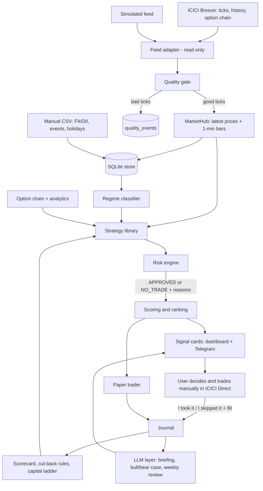

# Architecture

## 1. Purpose and boundary

A single-user, local-first system that watches Indian market data, decides what kind of market day it is,
runs rule-based strategies suited to that day, sizes each idea against the user's capital and limits,
and presents ranked signal cards with a reason and a rupee estimate. The user places every order
manually in ICICI Direct.

**Hard boundary:** the system never places, modifies, cancels or squares off an order. There is no
order route, no order-capable SDK call, and no browser automation. `tests/test_safety.py` enforces this.

| In scope | Out of scope |
|---|---|
| Live and historical data through ICICI Breeze (read-only) | Any order placement or automated execution |
| Intraday and swing signals on cash stocks | Futures, margin trading facility, borrowed funds |
| Option buying on Nifty, Bank Nifty and stocks | Uncovered (naked) option selling of any kind |
| Hedged option selling: credit spreads, iron condor | High-frequency or latency-sensitive strategies |
| Paper trading, journal, scorecard, alerts | Multi-user access, cloud hosting, public network access |

## 2. Component view



K is outside the application. The only writes the user can make are journal entries.

## 3. Processing pipeline for one bar

1. Feed delivers a tick. `quality.check_tick` passes or quarantines it.
2. `MarketHub` updates the latest price and the open 1-minute bar; closed bars go to the store.
3. On each closed bar the engine reads the current regime (recomputed on a schedule and on bar close).
4. Each strategy whose `allowed_regimes` contains the regime receives bars and returns zero or more `Signal`s.
5. The risk engine sizes each signal and returns a `RiskDecision`.
6. Approved signals are scored, ranked, stored and paper-traded, and shown on the dashboard. They are alerted only if the
   trade type's switch is on (`alert_switches`, phase 6) **and** the strategy's `strategies.status` allows alerts; the top
   ones by score are sent. Switched-off types still paper-trade.
7. Open positions (taken from a card or entered manually, any trade type) are re-evaluated on every closed bar for exit
   calls: target, stop, breakeven, trailing stop, partial booking, time exit, entry reason invalidated, regime flip,
   kill switch (stock option spreads add: short strike breached or trend flip with exit and roll numbers, forced exit
   before expiry week). Each call states the action and the reason and repeats until the position is marked closed.
   Exit calls are always sent, whatever the switches.

Anything unknown at any step (stale price, missing lot size, unknown margin) produces `NO_TRADE`, never a guess.

## 4. Technology

| Layer | Choice | Reason |
|---|---|---|
| Language | Python 3.11+ | User's main stack |
| Web/API | FastAPI + uvicorn, bound to 127.0.0.1 | Small, testable, local only |
| UI | Server-rendered HTML + small vanilla JS, polling JSON routes | No build step; one user |
| Storage | SQLite (one file per feed mode under `data/`) | Zero operations; enough for one user |
| Config | `config.yaml` validated by pydantic | Every limit a % of capital |
| Secrets | `.env` loaded at start, never committed | Breeze and Telegram tokens |
| Broker data | `breeze-connect` SDK, imported only in `app/feeds/breeze_feed.py` | Single choke point |
| LLM | Claude CLI (`claude -p`, JSON schema, tools disabled) behind `ResearchModel` | Swappable; never in the signal path |
| Tests | pytest, property-based tests for payoff and sizing | Arithmetic must be exact |
| Scheduling | In-process scheduler thread; optional Windows Task Scheduler to start the app | Simple |

Do not add Kafka, Redis, Celery, Docker orchestration, LangGraph or a JS framework unless a phase explicitly needs it.

## 5. Folder layout (target)

```
trading_system/
  CLAUDE.md
  config.yaml
  .env                      # not committed
  app/
    main.py                 # FastAPI app factory and routes
    page.py                 # HTML pages
    config.py               # pydantic settings
    models.py               # Tick, Bar (phase 1); Signal, RiskDecision added later
    quality.py  bars.py  store.py  hub.py
    feeds/      base.py  sim.py  breeze_feed.py
    history.py  indicators.py  regime.py  calendar.py  manual_data.py   # phase 2
    watchlist.py                                             # Nifty 50 file -> watchlist block
    strategies/ base.py  orb.py  vwap_pullback.py  range_reversion.py
                swing_pullback.py  swing_breakout.py         # phase 3
                orb_v2.py  range_reversion_v2.py             # phase 3b (v1 kept for comparison)
                swing_pullback_v2.py  swing_breakout_v2.py
    costs.py  backtest.py                                    # phase 3 (PointInTimeRegime in regime.py)
    options/    chain.py  payoff.py  analytics.py             # phase 4 (analytics.py also holds OptionDesk for the page)
                long_option.py  credit_spread.py  iron_condor.py
                base.py  greeks.py  option_history.py        # OptionContext and strike rules; IV/delta by code; Breeze option history
                instruments.py  margin.py  backtest.py       # lot sizes/expiries from the broker list; manual margins; option backtests
                stock_credit_spread.py  universe.py  shortlist.py  # phase 9 (built after phase 6)
    risk/       sizing.py  portfolio.py  limits.py  engine.py  # phase 5
    engine.py  scoring.py  paper.py  alerts.py  positions.py   # phase 6 (positions: exit calls, manual entry)
    switches.py                                               # phase 6: trade-type alert switches
    journal.py  scorecard.py  cutback.py  ladder.py            # phase 7
    llm/        base.py  claude_cli.py  prompts.py             # phase 8
  data/         market.db  events.csv  holidays.csv  fii_dii.csv
  docs/         architecture.md  implementation.md  STATUS.md  AFTER_EACH_PHASE.md
  scripts/      lookup_code.py  update_watchlist.py
  tests/
```

## 6. Core contracts

These are the shapes other modules rely on. Add fields when needed; do not rename or remove without updating every user and its tests.

```python
@dataclass
class Tick:            # exists
    symbol: str; last: float; bid: float | None; ask: float | None
    cum_volume: float | None; prev_close: float | None
    source: str; received_at: datetime          # UTC
    day_high: float | None; day_low: float | None   # phase 2: session high/low from the feed, if sent

@dataclass
class Bar:             # exists
    symbol: str; start: datetime; open: float; high: float; low: float; close: float
    volume: float | None; ticks: int             # None = unknown (index history)

@dataclass(frozen=True)
class Signal:          # phase 3 (app/models.py; validated on creation, see signal_problems())
    signal_id: str                 # uuid5 of strategy, version, symbol, direction, bar time (deterministic)
    created_at: datetime           # UTC, time of the bar that produced it
    strategy_id: str; strategy_version: str
    symbol: str
    asset_class: str               # CASH_EQUITY | INDEX_OPTION | STOCK_OPTION
    direction: str                 # LONG | SHORT | SPREAD
    horizon: str                   # INTRADAY | SWING | WEEKLY | MONTHLY
    entry: float; stop: float; target: float
    valid_until: datetime
    regime: str
    why_now: list[str]             # plain-language conditions that fired, with values
    legs: list[OptionLeg] | None   # options only: action, right, strike, expiry, lots, price, lot_size
    details: dict | None           # options only (phase 4), for ONE lot: premium, lot size, total cost, max loss in
                                   # rupees and % of capital, max profit, breakevens, costs, margin, warnings, exit rules
    data_as_of: datetime           # never later than created_at
    entry_zone: (low, high) | None # phase 3: optional acceptable fill range
    # entry = the signal bar's close (reference only); fills happen at the next bar's open at the earliest

@dataclass
class RiskDecision:    # phase 5
    status: str                    # APPROVED | NO_TRADE
    reason_codes: list[str]
    quantity: int | None; lots: int | None
    risk_inr: float | None; risk_pct: float | None
    est_profit_inr: float | None; est_loss_inr: float | None; costs_inr: float | None
    margin_inr: float | None
    capital_fit: str | None        # FITS | TIGHT | NEEDS_MORE_CAPITAL
    warnings: list[str]

class Strategy(ABC):               # phase 3 (app/strategies/base.py)
    id: str; version: str          # version = base version + hash of its config thresholds
    horizon: str; interval: str    # INTRADAY on 5minute bars | SWING on 1day bars
    allowed_regimes: frozenset[str]
    prior_sessions_needed: int     # phase 3b: previous sessions of 5-minute bars wanted in the context
    needs_index_daily: bool        # phase 3b: whether the context carries the index's daily bars
    uses_cost_estimate: bool       # phase 3b: built with round_trip_cost_pct (part of the version hash)
    def evaluate(self, ctx: MarketContext) -> list[Signal]: ...   # [] if regime not allowed, status not LIVE, or an index

class ResearchModel(Protocol):     # phase 8
    def complete(self, task: str, payload: dict, schema: dict) -> dict: ...
```

Option strategies (phase 4) subclass `Strategy` as `OptionStrategy` and take an `OptionContext` (underlying, spot, regime,
unexpired expiries with lot sizes, a `Quotes` provider, IV rank, the underlying's trigger signal, margin lookup). The same
strategy code runs on live chain quotes (bid/ask) and on stored option history (last traded prices; `historical=True`).
For a SPREAD signal, `entry` is the net credit per share and `stop` / `target` are the cost to buy the spread back.
`strategy.last_no_trade` lists the reason codes of the last evaluation.

`MarketContext` (phase 3: symbol, kind, asof, regime, intraday 5-minute bars of the session, daily bars, price status;
phase 3b: `prior_sessions`, the previous sessions' 5-minute bars, and `index_daily`, the index's daily bars up to the signal
day) carries what a strategy may see for one symbol at one moment; later phases add bias, events and option analytics.
Data after `asof` in any field raises `LookAheadError`.
Version-2 strategies have their own ids (`orb_v2`, ...); v1 stays unchanged. Ids in `strategies.inactive` are kept in code
but not run by default (phase 3b: `vwap_pullback`, retired from cash trading).
A strategy must be a pure function of its context: same input, same output, no network, no clock reads.

### Enumerations

- **Regime:** `TRENDING_UP`, `TRENDING_DOWN`, `RANGE`, `VOLATILE`, `EVENT`, `UNKNOWN`
- **Bias (from FII/DII):** `BULLISH`, `BEARISH`, `NEUTRAL`, `UNKNOWN`
- **Price status:** `LIVE`, `STALE`, `NO_DATA`, `CLOSED` (only `LIVE` is usable)
- **NO_TRADE reason codes:** `DATA_STALE`, `DATA_MISSING`, `OUTSIDE_REGIME`, `ZERO_SIZE`, `RISK_BUDGET_USED`,
  `DAILY_STOP`, `MONTHLY_PAUSE`, `DRAWDOWN_PAUSE`, `MARGIN_UNKNOWN`, `LOT_SIZE_UNKNOWN`, `UNHEDGED_SHORT`,
  `EVENT_BEFORE_EXPIRY`, `EXPIRY_WEEK`, `KILL_SWITCH`, `SIGNAL_EXPIRED`
- **Option NO_TRADE reason codes (phase 4):** `IV_RANK_UNKNOWN`, `IV_RANK_TOO_HIGH`, `IV_RANK_TOO_LOW`, `NO_TRIGGER`,
  `NO_EXPIRY`, `NO_STRIKE`, `NO_CREDIT`, `CREDIT_TOO_SMALL`, `ILLIQUID`, `PREMIUM_TOO_SMALL`, `NO_WEEKLY_OPTIONS`,
  `STOCK_OPTION_SELLING_NOT_ALLOWED` (phase 4: stock options are buy-only)
- **Warnings (do not block):** `NEEDS_MORE_CAPITAL`, `TIGHT_CAPITAL`, `SECTOR_LIMIT`, `MAX_SPREADS`, `UNPROVEN`, `LOW_SAMPLE`

## 7. Data model (SQLite)

| Table | Phase | Key columns |
|---|---|---|
| `bars_1m` | 1 | symbol, start_utc, o/h/l/c, volume, ticks, source |
| `quality_events` | 1 | at_utc, symbol, reason, last, bid, ask |
| `bars_5m`, `bars_1d` | 2 | symbol, source (`sim`/`breeze`), start_utc, o/h/l/c, volume. Daily bars keyed at 09:15 IST |
| `regime_log` | 2 | at_utc, session_date, regime, bias, reasons_json, rules_version, basis (LIVE/LAST_CLOSE) |
| `events`, `holidays`, `fii_dii` | 2 | loaded from CSV files the user maintains (events: date, type, symbol, note; fii_dii: date, fii_net_cr, dii_net_cr) |
| `backtest_runs`, `backtest_trades` | 3 | run_id, strategy_id, version, params_json, report_json; per-trade JSON. Reports also saved to `data/backtests/*.json` |
| `history_floor` | 3 | table, symbol, source, floor_utc: the source has no data before this (backfill is not re-asked) |
| `option_chain` | 4 | underlying, source, expiry, strike, right, as_of_utc, bid, ask, last, oi, oi_change, volume, spot. Rows with a missing or crossed bid/ask are quarantined, never stored. Snapshots older than 2 days are deleted |
| `option_bars` | 4 | underlying, expiry, strike, right, interval, source, start_utc, o/h/l/c, volume, oi. Breeze provides historical option prices (trades only, no bid/ask): downloaded per contract on demand |
| `option_fetch_log` | 4 | underlying, expiry, strike, right, interval, source, fetched_utc, rows: every contract asked for, also when nothing came back, so it is not asked for twice |
| `option_expiries`, `option_expiry_misses` | 4 | underlying, source, expiry, kind (weekly/monthly): expiry dates of EXPIRED contracts, found from the option history itself; and the weeks/months searched without a result |
| `instruments` | 4 | underlying, source, expiry, lot_size, kind (weekly/monthly), strikes_json, as_of_utc (current contracts, read from the broker's list; replaced on each refresh) |
| `margins` | 4 | underlying, structure (CREDIT_SPREAD/IRON_CONDOR), width, margin_per_lot_inr, as_of (entered by the user) |
| `signals` | 6 | signal_id, all Signal fields, RiskDecision fields, score, card_json |
| `paper_trades` | 6 | signal_id, entry/exit time and price, costs, net_pnl, exit_reason |
| `journal` | 6 | signal_id, decision (TOOK/SKIPPED), fill price, note, exit price |
| `positions` | 6 | open positions the user took or entered manually: origin (SIGNAL/MANUAL), trade type, legs (instrument or option legs), quantity/lots, entry, current stop/target, hedged flag (UNHEDGED shown in red), status, last exit call |
| `alert_switches` | 6 | trade type (intraday stocks, swing stocks, index option buying, index option selling, stock option buying, stock option selling), on/off (default off), changed_at; with a change log |
| `exit_calls` | 6 | position_id, at_utc, kind (TARGET, STOP, BREAKEVEN, TRAIL, PARTIAL, TIME, ENTRY_INVALIDATED, REGIME_FLIP, KILL_SWITCH, STRIKE_BREACHED, TREND_FLIP, FORCED_EXPIRY_EXIT), action text, reason values, repeat count |
| `shortlist` | 9 | session_date, stock, expiry, side, scores (IV rank, trend clarity, distance to S/R, liquidity), reasons, rank |
| `capital_log` | 7 | date, type (DEPOSIT/WITHDRAWAL), amount |
| `strategy_state` | 7 | strategy_id, regime, enabled, size_factor, changed_at, changed_by |
| `llm_calls` | 8 | at_utc, task, tokens/cost if known, ok, latency |

There is one SQLite file per feed mode, `data/market_sim.db` and `data/market_live.db` (`storage.db_path_sim` / `db_path_live`, chosen from `feed.mode`).
The live file refuses any row whose source is `sim`.
All timestamps are stored in UTC and shown in IST. Signals and their evidence are never edited after creation.

## 8. Configuration

`config.yaml` holds everything tunable. Existing sections: `account`, `risk`, `feed`, `watchlist`, `server`, `storage`,
`regime`, `bias`, `history`, `calendar` (phase 2).
`watchlist` entries are `{symbol, breeze_code, kind, sector?}`. The stock entries between the `nifty50` markers are generated by
`scripts/update_watchlist.py`, and breadth uses every stock entry. `feed.subscribe_pause_seconds` and `history.request_pause_seconds` /
`empty_retries` / `retry_pause_seconds` pace the Breeze calls.
Phase 3 adds `costs` (every rate with source and effective date; empty = backtests refuse to run), `strategies.<id>` and `backtest`.
Phase 3b adds `strategies.inactive`, the v2 strategy blocks, `backtest.holdout_start` (fixed holdout dates per bar interval)
and `regime.ignore_5m_bar_starts` (stored 5-minute bars the backtest regime skips: Breeze's 15:15 and 15:20 bars).
2026-11-13 adds `strategies.status` (per strategy: alerts on/off, paper_only/live, evidence label; every phase 3 cash strategy
is set to no alerts, paper only, "negative in backtests").
Phase 4 adds `strategies.long_option` / `credit_spread` / `iron_condor` (with `strategies.status` entries) and `options`
(risk-free rate and dividend assumptions for IV/delta, IV-rank lookback, per-underlying expiries and backtest strike step,
chain refresh/staleness/liquidity limits, margin file and maximum age, option backtest underlyings/start/request limit).
Later phases add: `position_cap_pct` (default 25), `scoring`, `alerts` (repeat interval for exit calls, daily cap), `stock_option_selling` (phase 9: universe filters
min_open_interest and max_bid_ask_spread_pct, shortlist size and ranking weights, max_short_delta 0.20, hedge_strikes_out 2-3,
max_loss_per_stock_spread_pct, entry window 20-35 days to expiry, profit_target_pct_of_credit 50, stop_multiple_of_credit 2,
exit_days_before_expiry, recommended_capital_inr), `cutback`, `ladder`, `llm`, `go_live_gate`.

Rules:
- Every rupee limit is derived as a percentage of `account.capital_inr`.
- Each new section gets a pydantic model with ranges; an invalid config stops the app at start.
- `server.host` must stay `127.0.0.1` or `localhost`.
- Cost rates carry an `effective_from` date and must be filled by the user; empty rates raise an error.

Current defaults: 1% loss per trade, 2.5% per option position, 2% daily stop, 6% monthly pause,
25% cash uncommitted, 25% position-value cap, halve sizes at 10% drawdown, pause at 15%.

## 9. Instruments and option rules

| Instrument | Buying | Selling | Rule |
|---|---|---|---|
| Cash stocks | Intraday, swing | n/a | No leverage or borrowed funds |
| Nifty options | Weekly, monthly | Credit spread, iron condor | Cash-settled |
| Bank Nifty options | Monthly | Credit spread | Weekly contracts do not exist |
| Stock options | Monthly | Hedged credit spread (phase 9): bull put / bear call, 20-35 days to expiry | Physically settled: no position in expiry week |

- A short option without a bought option of the same underlying, right and expiry (further out of the money, at least as
  many shares) is rejected (`UNHEDGED_SHORT`) at three boundaries: the `Signal` model itself, the option backtest entry and
  `Store.save_backtest()`. The system never suggests an
  unhedged position (entry or roll). A position the user already holds and enters manually may be unhedged: it is stored,
  flagged UNHEDGED on every view and alert, and still gets exit calls.
- Phase 9 short strike: beyond the nearest support (puts) or resistance (calls), beyond the highest-OI strike on that side,
  and |delta| at or below `max_short_delta`; otherwise no signal. Hedge: same expiry, `hedge_strikes_out` strikes further out,
  liquid, keeping max loss within `max_loss_per_stock_spread_pct`.
- Universe for stock option selling: every NSE F&O stock in the broker's instrument list that passes the liquidity filters
  on the strikes to be traded (not limited to the watchlist).
- Option backtests use stored Breeze option prices if they exist, else they are labelled "payoff simulation"; each is
  compared with a no-filter baseline (the same structure every month or week, no entry rules). Phase 4 finding: Breeze
  has them (expired contracts too, back to at least 2017, with volume and OI; trades only, no bid/ask), so breeze-source
  option backtests use `option_bars`; only the sim source uses model prices. Every trade records its price source.
- Margin is entered by the user from ICICI's margin calculator (`margins` table); Breeze's margin calculator is not a
  data call and is not used. A spread without a current margin entry gives no signal (`MARGIN_UNKNOWN`).
- IV rank: India VIX against its past year for an index; stored at-the-money implied volatility for a stock, point in time
  (a contract is used only from the day its strike was chosen, so a day's value never depends on a later close). Unknown
  IV rank means no signal. Options are bought only at or below `max_iv_rank` and spreads sold only at or above `min_iv_rank`.
- Sold strikes: |delta| at or below the limit (delta from the strike's own price) and, live, beyond the highest-OI strike.
  In backtests the highest-OI rule is not applied (history has no chain-wide open interest).
- Lot sizes and expiry dates are read from the broker's instrument list at run time. Never hardcode them.
- Capital never hides a stock option selling signal; the card carries a capital-fit label instead.

## 10. HTTP routes

Read-only: `/health`, `/`, `/api/prices`, `/api/quality`, `/api/bars/{symbol}`, `/api/config` (phase 1);
`/api/regime` (2); `/api/backtests`, `/api/backtests/{run_id}` and the page `/backtests` (3); `/api/options`,
`/api/options/{underlying}` and the page `/options` (4);
`/api/risk` (5); `/api/signals`, `/api/signals/{id}`, `/api/positions`, `/api/alert-switches` (6);
`/api/stock-option-selling/shortlist` and the page `/stock-option-selling` (9); `/api/scorecard` (7); `/api/briefing` (8).

Writes (journal and manual data only): `POST /journal/{signal_id}/decision`, `POST /journal/{signal_id}/exit`,
`POST /journal/alert-switches` (6), `POST /journal/positions` and `POST /journal/positions/{id}/close` (manual positions,
6; option legs and the UNHEDGED flag, 9), `POST /data/import/{kind}` for FII/DII, events, holidays and margin entries (`margins`, phase 4),
`POST /capital/log`. Route names avoid the forbidden word list (for example `alert-switches`, never `trade/`).

Forbidden in any path: `order`, `execute`, `square`, `submit`, `trade/`. The safety test checks every route.

Every non-GET/HEAD request must have Host `127.0.0.1:<port>` or `localhost:<port>`, a matching Origin if one is sent,
and Content-Type `application/json` (403 / 415 otherwise). `POST /data/import/{kind}` takes `{"text": "<csv>"}`.

Phase 1's safety test allows no write routes at all. From phase 2, replace that single check with an allowlist: write routes may exist only under `/journal/`, `/data/import/` and `/capital/`. This is the one permitted change to `tests/test_safety.py`; every other safety check stays as it is or gets stricter.

## 11. LLM layer

- Interface: `ResearchModel.complete(task, payload, schema) -> dict`, validated against the schema.
- Backend: Claude CLI subprocess, `--output-format json --json-schema`, tools disabled, timeout, daily call budget.
- Tasks: pre-market briefing, bull/bear case per approved signal, event-risk tagging of news, weekly journal review.
- Inputs are sanitized facts only: no credentials, account numbers or personal identifiers.
- A reply containing any price, quantity or strike not present in the input is rejected.
- News text and model output are untrusted data; instructions inside them are ignored.
- The model can pause a symbol (`EVENT_RISK`). It cannot create, approve or size a trade.
- On failure, timeout or exhausted budget the system continues with "no AI commentary".

## 12. Safety and security

- No order capability, enforced by tests over source, routes and imports.
- Local-only binding; no authentication is needed because nothing is exposed.
- Secrets only in `.env`; `.gitignore` covers `.env` and `data/*.db`.
- Kill switch: stale index feed, spike in quarantined ticks, or outside market hours stops all signals.
- Heartbeat alert if the feed or engine stops during market hours.
- Automatic rules may only reduce risk. Any increase in size, re-enabling of a strategy, or change of
  `account.mode` to `live_manual` requires an explicit user action recorded in the journal.

## 13. Testing strategy

| Kind | What it covers |
|---|---|
| Unit | Indicators, quality rules, sizing, payoff, costs, regime rules |
| Property-based | Payoff bounds, sizing never exceeds configured risk |
| Fixture replay | Bars in, signals out; identical on every run |
| Look-ahead guard | Backtest fails if the signal bar is used as a fill |
| Reconciliation | Fixture trade net P&L matches to the paise |
| Safety | No order code, no forbidden routes, SDK imported in one file, local host only |
| End to end | Fixture bars to stored signal card through the HTTP API |

Tests run offline. Anything needing the live broker goes behind the feed interface and is listed as untested in `docs/STATUS.md`.

## 14. Validation path to live use

1. Backtest with costs and walk-forward split (phase 3).
2. Paper trading of every signal, 8-12 weeks, at least 50 closed trades (phases 6-7).
3. Go-live gate report per strategy: PASS, FAIL or NOT ENOUGH DATA (phase 8).
4. User switches `account.mode` to `live_manual` for strategies that passed.
5. Capital ladder governs increases; step-ups are judged per strategy.

Backtest engine rules every phase reuses (`app/backtest.py`): entry at the next bar's open; no trade if the fill after
slippage is at or beyond the stop or target; an intraday session is traded only if it has every 5-minute bar from 09:15
to the bar ending at `backtest.intraday_exit_time`; a trade crossing a missing bar is dropped, never given an invented
exit. Daily-bar trades (swing, and option positions): a session the index traded for which the stock or an option leg
has no bar is a missing bar; a position open across one is dropped, and a signal is entered only on the next market session.
Reports list `skipped_signals` and `data_exclusions`.

Option backtests (`app/options/backtest.py`) reuse these rules: signal at a day's close, entry at the next session's open
of every leg with slippage per leg, spread exits decided on closes and filled at the next open, never held to settlement,
one lot per trade at today's lot size (sizing is phase 5). The no-filter baseline makes one attempt per expiry (or month)
on a date fixed by the calendar; a skipped attempt is recorded and never retried. Reports are labelled "excludes margin
and bid/ask eligibility checks" (both stay mandatory for live signals).

Option backtests are labelled "payoff simulation" unless real historical option quotes are stored, and always show a
no-filter baseline beside the strategy. Backtests do not test sessions before 2019-01-22 (Breeze history before that is unreliable).

**Build order (2026-11-13):** phases 1-3 done, then 4, 5, 6, 9, 7, 8. Phase 9 (stock option selling) comes before the
journal/scorecard (7) and LLM (8) phases because the user trades monthly hedged stock option selling now; it uses only
phases 4, 5 and 6.

## 15. Open decisions (user)

| Decision | Default until decided |
|---|---|
| Intraday leverage | None. Position value capped at 25% of capital, so intraday cash trades are small |
| Breeze read-only use | Proceed; user to confirm with ICICI in writing |
| Brokerage and tax rates | 2026-11-13: Prime 4999 brokerage (user); NSE charges per circular NSE/FA/73061 (IPFT included in the exchange charge); other statutory rates from published sources. Labelled "not yet verified against a contract note". User to verify against a contract note |
| Watchlist | NIFTY, BANKNIFTY, INDIAVIX and the Nifty 50 stocks (2026-11-12), codes mapped from ICICI's instrument list by symbol and ISIN |
| Risk percentages | As in section 8 |
| Alert rule for a switched-on trade type | Alert only if the strategy's `strategies.status` also allows alerts (so "negative in backtests" strategies stay silent). User may decide that the switch alone should be enough |
| Stock spread stop "2x credit" | Close when the cost to buy back the spread reaches 2x the credit received (loss about 1x credit before costs). User to confirm |

## 16. Source-of-truth order

1. Current exchange and broker rules. 2. The user's actual fills and contract notes. 3. Tested risk and payoff code.
4. Stored market data that passed the quality gate. 5. Strategy rules. 6. LLM commentary.
Nothing lower may override anything higher.
