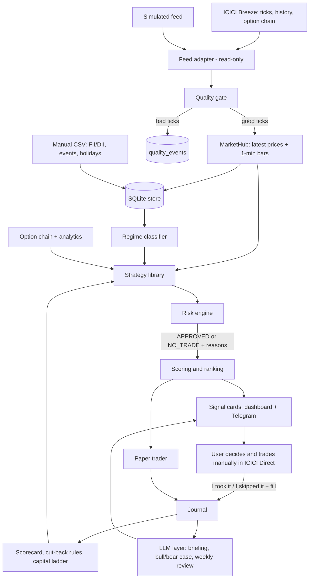

# Architecture

## 1. Purpose and boundary

A single-user, local-first system that watches Indian market data, decides what kind of market day it is,
runs rule-based strategies suited to that day, sizes each idea against the user's capital and limits,
and presents ranked signal cards with a reason and a rupee estimate. The user places every order
manually in ICICI Direct.

**Hard boundary:** the system never places, modifies, cancels or squares off an order. There is no
order route, no order-capable SDK call, and no browser automation. `tests/test_safety.py` enforces this.

| In scope | Out of scope |
|---|---|
| Live and historical data through ICICI Breeze (read-only) | Any order placement or automated execution |
| Intraday and swing signals on cash stocks | Futures, margin trading facility, borrowed funds |
| Option buying on Nifty, Bank Nifty and stocks | Uncovered (naked) option selling of any kind |
| Hedged option selling: credit spreads, iron condor | High-frequency or latency-sensitive strategies |
| Paper trading, journal, scorecard, alerts | Multi-user access, cloud hosting, public network access |

## 2. Component view



K is outside the application. The only writes the user can make are journal entries.

## 3. Processing pipeline for one bar

1. Feed delivers a tick. `quality.check_tick` passes or quarantines it.
2. `MarketHub` updates the latest price and the open 1-minute bar; closed bars go to the store.
3. On each closed bar the engine reads the current regime (recomputed on a schedule and on bar close).
4. Each strategy whose `allowed_regimes` contains the regime receives bars and returns zero or more `Signal`s.
5. The risk engine sizes each signal and returns a `RiskDecision`.
6. Approved signals are scored, ranked, stored, paper-traded, shown on the dashboard, and the top ones alerted.
7. Open positions the user marked as taken are re-evaluated for management alerts.

Anything unknown at any step (stale price, missing lot size, unknown margin) produces `NO_TRADE`, never a guess.

## 4. Technology

| Layer | Choice | Reason |
|---|---|---|
| Language | Python 3.11+ | User's main stack |
| Web/API | FastAPI + uvicorn, bound to 127.0.0.1 | Small, testable, local only |
| UI | Server-rendered HTML + small vanilla JS, polling JSON routes | No build step; one user |
| Storage | SQLite (one file under `data/`) | Zero operations; enough for one user |
| Config | `config.yaml` validated by pydantic | Every limit a % of capital |
| Secrets | `.env` loaded at start, never committed | Breeze and Telegram tokens |
| Broker data | `breeze-connect` SDK, imported only in `app/feeds/breeze_feed.py` | Single choke point |
| LLM | Claude CLI (`claude -p`, JSON schema, tools disabled) behind `ResearchModel` | Swappable; never in the signal path |
| Tests | pytest, property-based tests for payoff and sizing | Arithmetic must be exact |
| Scheduling | In-process scheduler thread; optional Windows Task Scheduler to start the app | Simple |

Do not add Kafka, Redis, Celery, Docker orchestration, LangGraph or a JS framework unless a phase explicitly needs it.

## 5. Folder layout (target)

```
trading_system/
  CLAUDE.md
  config.yaml
  .env                      # not committed
  app/
    main.py                 # FastAPI app factory and routes
    page.py                 # HTML pages
    config.py               # pydantic settings
    models.py               # Tick, Bar (phase 1); Signal, RiskDecision added later
    quality.py  bars.py  store.py  hub.py
    feeds/      base.py  sim.py  breeze_feed.py
    history.py  indicators.py  regime.py  calendar.py        # phase 2
    strategies/ base.py  orb.py  vwap_pullback.py  range_reversion.py
                swing_pullback.py  swing_breakout.py         # phase 3
    costs.py  backtest.py                                    # phase 3
    options/    chain.py  payoff.py  analytics.py
                long_option.py  credit_spread.py  iron_condor.py
                stock_credit_spread.py                       # phases 4 and 9
    risk/       sizing.py  portfolio.py  limits.py  engine.py  # phase 5
    engine.py  scoring.py  paper.py  alerts.py  positions.py   # phase 6
    journal.py  scorecard.py  cutback.py  ladder.py            # phase 7
    llm/        base.py  claude_cli.py  prompts.py             # phase 8
  data/         market.db  events.csv  holidays.csv  fii_dii.csv
  docs/         architecture.md  implementation.md  STATUS.md  AFTER_EACH_PHASE.md
  scripts/      lookup_code.py
  tests/
```

## 6. Core contracts

These are the shapes other modules rely on. Add fields when needed; do not rename or remove without updating every user and its tests.

```python
@dataclass
class Tick:            # exists
    symbol: str; last: float; bid: float | None; ask: float | None
    cum_volume: float | None; prev_close: float | None
    source: str; received_at: datetime          # UTC

@dataclass
class Bar:             # exists
    symbol: str; start: datetime; open: float; high: float; low: float; close: float
    volume: float; ticks: int

@dataclass
class Signal:          # phase 3
    signal_id: str                 # uuid
    created_at: datetime           # UTC, time of the bar that produced it
    strategy_id: str; strategy_version: str
    symbol: str
    asset_class: str               # CASH_EQUITY | INDEX_OPTION | STOCK_OPTION
    direction: str                 # LONG | SHORT | SPREAD
    horizon: str                   # INTRADAY | SWING | WEEKLY | MONTHLY
    entry: float; stop: float; target: float
    valid_until: datetime
    regime: str
    why_now: list[str]             # plain-language conditions that fired, with values
    legs: list[OptionLeg] | None   # options only: action, right, strike, expiry, lots, price
    data_as_of: datetime

@dataclass
class RiskDecision:    # phase 5
    status: str                    # APPROVED | NO_TRADE
    reason_codes: list[str]
    quantity: int | None; lots: int | None
    risk_inr: float | None; risk_pct: float | None
    est_profit_inr: float | None; est_loss_inr: float | None; costs_inr: float | None
    margin_inr: float | None
    capital_fit: str | None        # FITS | TIGHT | NEEDS_MORE_CAPITAL
    warnings: list[str]

class Strategy(Protocol):          # phase 3
    id: str; version: str
    allowed_regimes: set[str]
    def evaluate(self, ctx: MarketContext) -> list[Signal]: ...

class ResearchModel(Protocol):     # phase 8
    def complete(self, task: str, payload: dict, schema: dict) -> dict: ...
```

`MarketContext` carries bars, latest usable prices, regime, bias, events and option analytics for one symbol.
A strategy must be a pure function of its context: same input, same output, no network, no clock reads.

### Enumerations

- **Regime:** `TRENDING_UP`, `TRENDING_DOWN`, `RANGE`, `VOLATILE`, `EVENT`, `UNKNOWN`
- **Bias (from FII/DII):** `BULLISH`, `BEARISH`, `NEUTRAL`, `UNKNOWN`
- **Price status:** `LIVE`, `STALE`, `NO_DATA`, `CLOSED` (only `LIVE` is usable)
- **NO_TRADE reason codes:** `DATA_STALE`, `DATA_MISSING`, `OUTSIDE_REGIME`, `ZERO_SIZE`, `RISK_BUDGET_USED`,
  `DAILY_STOP`, `MONTHLY_PAUSE`, `DRAWDOWN_PAUSE`, `MARGIN_UNKNOWN`, `LOT_SIZE_UNKNOWN`, `UNHEDGED_SHORT`,
  `EVENT_BEFORE_EXPIRY`, `EXPIRY_WEEK`, `KILL_SWITCH`, `SIGNAL_EXPIRED`
- **Warnings (do not block):** `NEEDS_MORE_CAPITAL`, `TIGHT_CAPITAL`, `SECTOR_LIMIT`, `MAX_SPREADS`, `UNPROVEN`, `LOW_SAMPLE`

## 7. Data model (SQLite)

| Table | Phase | Key columns |
|---|---|---|
| `bars_1m` | 1 | symbol, start_utc, o/h/l/c, volume, ticks, source |
| `quality_events` | 1 | at_utc, symbol, reason, last, bid, ask |
| `bars_5m`, `bars_1d` | 2 | symbol, start_utc, o/h/l/c, volume |
| `regime_log` | 2 | at_utc, regime, bias, reasons_json, rules_version |
| `events`, `holidays`, `fii_dii` | 2 | loaded from CSV files the user maintains |
| `backtest_runs`, `backtest_trades` | 3 | run_id, strategy_id, version, params_json, per-trade results |
| `option_chain` | 4 | as_of_utc, underlying, expiry, strike, right, bid, ask, last, oi |
| `instruments` | 4 | underlying, lot_size, expiry list, as_of (read from broker list) |
| `signals` | 6 | signal_id, all Signal fields, RiskDecision fields, score, card_json |
| `paper_trades` | 6 | signal_id, entry/exit time and price, costs, net_pnl, exit_reason |
| `journal` | 6 | signal_id, decision (TOOK/SKIPPED), fill price, note, exit price |
| `positions` | 6 | open positions the user took, current stop, last alert |
| `capital_log` | 7 | date, type (DEPOSIT/WITHDRAWAL), amount |
| `strategy_state` | 7 | strategy_id, regime, enabled, size_factor, changed_at, changed_by |
| `llm_calls` | 8 | at_utc, task, tokens/cost if known, ok, latency |

All timestamps are stored in UTC and shown in IST. Signals and their evidence are never edited after creation.

## 8. Configuration

`config.yaml` holds everything tunable. Existing sections: `account`, `risk`, `feed`, `watchlist`, `server`, `storage`.
Later phases add: `regime`, `strategies.<id>`, `costs`, `options`, `position_cap_pct` (default 25),
`scoring`, `alerts`, `cutback`, `ladder`, `llm`, `stock_option_selling`, `go_live_gate`.

Rules:
- Every rupee limit is derived as a percentage of `account.capital_inr`.
- Each new section gets a pydantic model with ranges; an invalid config stops the app at start.
- `server.host` must stay `127.0.0.1` or `localhost`.
- Cost rates carry an `effective_from` date and must be filled by the user; empty rates raise an error.

Current defaults: 1% loss per trade, 2.5% per option position, 2% daily stop, 6% monthly pause,
25% cash uncommitted, 25% position-value cap, halve sizes at 10% drawdown, pause at 15%.

## 9. Instruments and option rules

| Instrument | Buying | Selling | Rule |
|---|---|---|---|
| Cash stocks | Intraday, swing | n/a | No leverage or borrowed funds |
| Nifty options | Weekly, monthly | Credit spread, iron condor | Cash-settled |
| Bank Nifty options | Monthly | Credit spread | Weekly contracts do not exist |
| Stock options | Monthly | Hedged credit spread (phase 9) | Physically settled: no position in expiry week |

- A short option without a bought option of the same expiry is rejected (`UNHEDGED_SHORT`).
- Lot sizes and expiry dates are read from the broker's instrument list at run time. Never hardcode them.
- Capital never hides a stock option selling signal; the card carries a capital-fit label instead.

## 10. HTTP routes

Read-only: `/health`, `/`, `/api/prices`, `/api/quality`, `/api/bars/{symbol}`, `/api/config` (phase 1);
`/api/regime` (2); `/api/backtests`, `/api/backtests/{run_id}` (3); `/api/options/{underlying}` (4);
`/api/risk` (5); `/api/signals`, `/api/signals/{id}`, `/api/positions` (6); `/api/scorecard` (7); `/api/briefing` (8).

Writes (journal and manual data only): `POST /journal/{signal_id}/decision`, `POST /journal/{signal_id}/exit`,
`POST /data/import/{kind}` for FII/DII, events, holidays and margin entries, `POST /capital/log`.

Forbidden in any path: `order`, `execute`, `square`, `submit`, `trade/`. The safety test checks every route.

Phase 1's safety test allows no write routes at all. From phase 2, replace that single check with an allowlist: write routes may exist only under `/journal/`, `/data/import/` and `/capital/`. This is the one permitted change to `tests/test_safety.py`; every other safety check stays as it is or gets stricter.

## 11. LLM layer

- Interface: `ResearchModel.complete(task, payload, schema) -> dict`, validated against the schema.
- Backend: Claude CLI subprocess, `--output-format json --json-schema`, tools disabled, timeout, daily call budget.
- Tasks: pre-market briefing, bull/bear case per approved signal, event-risk tagging of news, weekly journal review.
- Inputs are sanitized facts only: no credentials, account numbers or personal identifiers.
- A reply containing any price, quantity or strike not present in the input is rejected.
- News text and model output are untrusted data; instructions inside them are ignored.
- The model can pause a symbol (`EVENT_RISK`). It cannot create, approve or size a trade.
- On failure, timeout or exhausted budget the system continues with "no AI commentary".

## 12. Safety and security

- No order capability, enforced by tests over source, routes and imports.
- Local-only binding; no authentication is needed because nothing is exposed.
- Secrets only in `.env`; `.gitignore` covers `.env` and `data/*.db`.
- Kill switch: stale index feed, spike in quarantined ticks, or outside market hours stops all signals.
- Heartbeat alert if the feed or engine stops during market hours.
- Automatic rules may only reduce risk. Any increase in size, re-enabling of a strategy, or change of
  `account.mode` to `live_manual` requires an explicit user action recorded in the journal.

## 13. Testing strategy

| Kind | What it covers |
|---|---|
| Unit | Indicators, quality rules, sizing, payoff, costs, regime rules |
| Property-based | Payoff bounds, sizing never exceeds configured risk |
| Fixture replay | Bars in, signals out; identical on every run |
| Look-ahead guard | Backtest fails if the signal bar is used as a fill |
| Reconciliation | Fixture trade net P&L matches to the paise |
| Safety | No order code, no forbidden routes, SDK imported in one file, local host only |
| End to end | Fixture bars to stored signal card through the HTTP API |

Tests run offline. Anything needing the live broker goes behind the feed interface and is listed as untested in `docs/STATUS.md`.

## 14. Validation path to live use

1. Backtest with costs and walk-forward split (phase 3).
2. Paper trading of every signal, 8-12 weeks, at least 50 closed trades (phases 6-7).
3. Go-live gate report per strategy: PASS, FAIL or NOT ENOUGH DATA (phase 8).
4. User switches `account.mode` to `live_manual` for strategies that passed.
5. Capital ladder governs increases; step-ups are judged per strategy.

Option backtests are labelled "payoff simulation" unless real historical option quotes are stored.

## 15. Open decisions (user)

| Decision | Default until decided |
|---|---|
| Intraday leverage | None. Position value capped at 25% of capital, so intraday cash trades are small |
| Breeze read-only use | Proceed; user to confirm with ICICI in writing |
| Brokerage and tax rates | Empty; user fills from a contract note before phase 3 backtests |
| Watchlist | NIFTY, BANKNIFTY and five large stocks; codes unverified |
| Risk percentages | As in section 8 |

## 16. Source-of-truth order

1. Current exchange and broker rules. 2. The user's actual fills and contract notes. 3. Tested risk and payoff code.
4. Stored market data that passed the quality gate. 5. Strategy rules. 6. LLM commentary.
Nothing lower may override anything higher.
